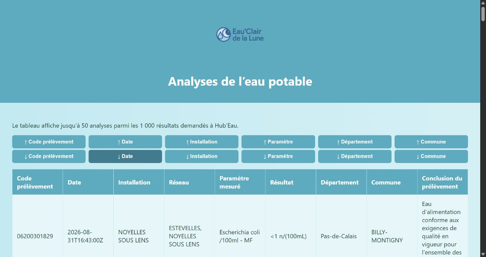

# Hub’Eau - Exploration des données sur l’eau potable

Projet universitaire réalisé en équipe. Cette application Flask propose deux parcours pour explorer les données publiques sur l’eau potable en France.

- **Carte** - Sélectionner un département, afficher ses communes puis consulter les réseaux d’eau associés. Cette vue s’appuie sur une base SQLite locale.
- **Tableau** - Consulter les résultats d’analyses et trier les lignes par date, lieu ou paramètre. Le site demande jusqu’à 1 000 résultats et affiche les 50 premiers après le tri. Cette vue nécessite une connexion Internet. [Documentation de l’API Hub’Eau](https://hubeau.eaufrance.fr/page/api-qualite-eau-potable)

## De l’API au tableau

Chaque ligne part d’un résultat d’analyse de `resultats_dis`. Le site reprend le paramètre, la commune et les réseaux de distribution. Il conserve le résultat textuel, par exemple « <1 », et ajoute son unité lorsqu’elle s’applique.

| Champ dans la réponse JSON | Affichage pour le prélèvement `06200301829` |
| --- | --- |
| `nom_commune` | BILLY-MONTIGNY |
| `libelle_parametre` | Escherichia coli /100ml - MF |
| `resultat_alphanumerique` et `libelle_unite` | <1 n/(100mL) |
| `reseaux[].nom` | ESTEVELLES, NOYELLES SOUS LENS |

Cet exemple provient d’un prélèvement du 31 août 2026. La réponse en direct peut évoluer. [Endpoint Hub’Eau](https://hubeau.eaufrance.fr/api/v1/qualite_eau_potable/resultats_dis?size=2)



Si l’API est indisponible, le tableau propose de réessayer ou d’ouvrir la carte des communes et réseaux. La carte consulte la base SQLite fournie avec le projet.

## Démarrer en local

Utilise Python 3.12 ou 3.14 et exécute les commandes depuis la racine du dépôt.

**Windows PowerShell**

```powershell
python -m venv .venv
.\.venv\Scripts\python.exe -m pip install -r requirements.txt
.\.venv\Scripts\python.exe prepare_data.py
.\.venv\Scripts\python.exe -m flask --app app run
```

**macOS ou Linux**

```bash
python -m venv .venv
source .venv/bin/activate
python -m pip install -r requirements.txt
python prepare_data.py
python -m flask --app app run
```

Ouvre [http://127.0.0.1:5000](http://127.0.0.1:5000). La commande de préparation récupère la base locale et le logo depuis `site-HubEau.zip`, qui contient l’état d’origine du projet.

## Lire le code

| Fichier ou dossier | Rôle |
| --- | --- |
| `app.py` | Point d’entrée Flask. |
| `controller/` | Routes de la carte et du tableau. |
| `model/` | Requêtes SQLite et récupération des analyses Hub’Eau. |
| `templates/` et `static/` | Pages HTML et styles. |
