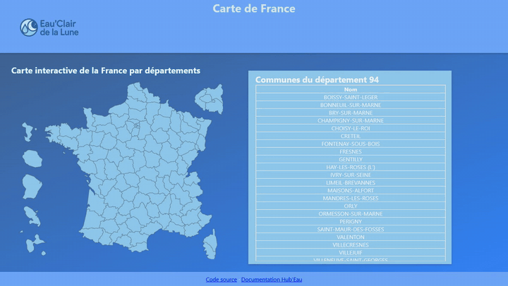

# Hub’Eau - Exploration des données sur l’eau potable

Projet universitaire réalisé en équipe. Cette application propose deux vues :

- **Carte** : choisir un département puis une commune pour consulter ses réseaux d’eau. Les données sont fournies dans une base SQLite locale.
- **Tableau** : consulter les analyses de l’eau potable et trier les résultats par date, lieu ou paramètre grâce à l’API Hub’Eau.

**Outils :** Python, Flask, SQLite et API REST.

## Aperçu du projet

L’aperçu montre la carte locale. Le tableau des analyses utilise séparément l’API en ligne.

[Image en grand format](docs/apercu.png) · [Voir la vidéo](docs/presentation.mp4)

## Télécharger et lancer

1. Installe [Python 3.14](https://www.python.org/downloads/) si besoin, en cochant **Add python.exe to PATH**.
2. [Télécharge le projet en ZIP](https://github.com/ArilesD/site-HubEau/archive/refs/heads/main.zip), fais **Extraire tout**, puis ouvre le dossier extrait.
3. Double-clique sur **LANCER.cmd**.

Le premier lancement nécessite Internet pour installer les bibliothèques. Garde la fenêtre de lancement ouverte pendant l’utilisation et appuie sur **Entrée** dans cette fenêtre pour arrêter le projet.

Dans **Carte de France**, sélectionne un département puis une commune. La base est fournie dans `data/`.

Le tableau des analyses nécessite Internet et dépend de la disponibilité de l’API. Il demande jusqu’à 1 000 résultats et affiche les 50 premiers après le tri. Si l’API est indisponible, la carte locale reste utilisable.

## Comprendre les fichiers

| Fichier ou dossier | Rôle |
| --- | --- |
| `LANCER.cmd` et `lancer.py` | Préparent et démarrent l’application. |
| `app.py` | Point d’entrée de l’application. |
| `controller/` | Pages de la carte et du tableau. |
| `model/` | Requêtes SQLite et récupération des données de l’API. |
| `templates/` et `static/` | Pages HTML, styles et images. |

[Documentation de l’API Hub’Eau](https://hubeau.eaufrance.fr/page/api-qualite-eau-potable) · [Exemple du tableau des analyses](docs/tableau-hubeau.jpg)
